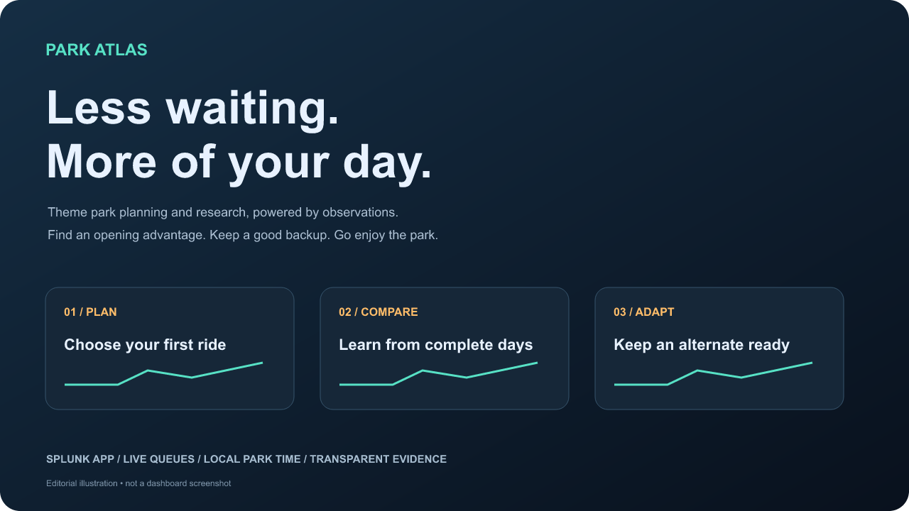
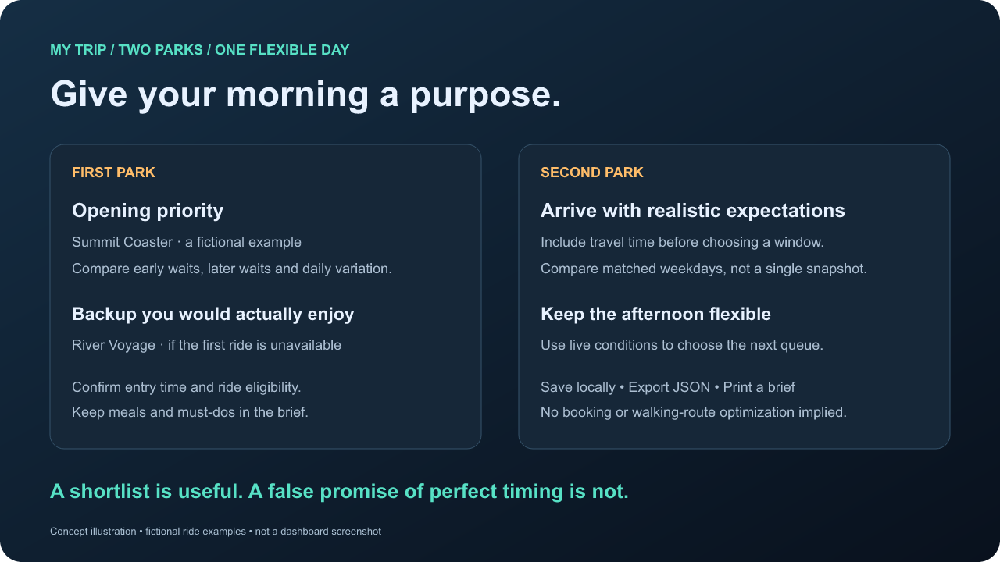
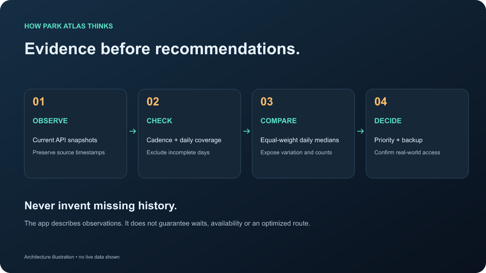

# Park Atlas



[](https://github.com/matt-snyder-stuff/theme_park_wait_times/actions/workflows/validate.yml)
[](LICENSE)

[Download the app](https://github.com/matt-snyder-stuff/theme_park_wait_times/releases) · [Read the story](docs/BLOG_DRAFT.md) · [Setup guide](#quick-start-with-docker)

**Plan less waiting. Make more memories.**

Park Atlas turns Queue-Times observations into a theme park planning and research workspace inside Splunk. Find rides with an opening advantage, compare hourly waits, understand availability patterns, and keep a backup ready.

This started with a question: *Which rides should I do first so I can save paid queue access for later?* It grew into a small research system for making better park-day decisions—with the evidence and limitations visible.

## Explore the app

| Workspace | The question it answers |
| --- | --- |
| My Trip | How do I turn a two-park shortlist into a saved, printable brief? |
| Start Here | Where should I begin, and is my data fresh? |
| Park Planner | What deserves my first 30 minutes at this park? |
| Disney World | How do I research a day across the four Walt Disney World parks? |
| Live Explorer | What are the queues and statuses right now? |
| Wait Research | How do waits vary over time? |
| Ride Reliability | When is an attraction unavailable, and how long do completed episodes last? |
| How to Read the Research | What do these numbers actually mean? |
| Data Health / Setup Guide | Is collection working, and how do I operate it? |

The app uses native Splunk Simple XML dashboards with a shared, responsive CSS theme. No external fonts, tracking scripts, API keys, or Python package dependencies are required for collection. The My Trip page uses a small local JavaScript extension for browser-local saves and exports.

## A trip plan you can work with



*Original concept illustration with fictional rides, not a screenshot. Actual app screenshots are pending live browser review.*

Open **My Trip**, choose your two parks, enter your visit date and confirmed entry time, and allow time for the park transfer. Pick ride shortlists, record party needs and commitments, then Apply. Compare equal-weight daily medians and the range of observed daily advantages. Save a brief on this browser, download/import a private JSON backup, or print it. Ride menus follow the park currently selected, and selecting specific rides overrides “All rides.”

Browser saves are scoped to your Splunk username and do not sync between devices. Party notes are reminders, not an eligibility engine. The app does not automatically enforce reservations, optimize walking routes, or verify early-entry access. Research looks back 60 days to support up to seven matching weekdays. Arrival windows begin no earlier than your transfer permits. Both parks are assumed to share a timezone. Never sum opening advantages as if all rides could be entered simultaneously.

## Quick start with Docker

Prerequisites: Docker Compose, Python 3.9+, and sufficient resources for Splunk. The example uses Splunk Enterprise 9.4.13 on amd64; Apple Silicon uses emulation. Starting the container uses Splunk's license-acceptance flag; review the vendor terms before running it.

```sh
python3 scripts/setup_local.py
docker compose up -d
```

Open **http://localhost:8000/en-US/app/queue_times/start_here** after initialization. Sign in as `admin` using the generated password in `.env`. This file is private, git-ignored and excluded from release packages. The setup command never overwrites an existing `.env` or local input configuration.

The Docker example collects Disney World every five minutes and all other API-listed parks every fifteen minutes. Edit `queue_times/local/inputs.conf` to choose your scope; restart the container after changes. Persistent Docker volumes retain indexed data. Ports are bound to localhost.

```sh
docker compose logs --tail 50 splunk
docker compose stop
```

A sleeping laptop cannot collect data. Use an always-on host for uninterrupted history. Never expose this development setup publicly without appropriate authentication, TLS and network controls.

## Install in an existing Splunk deployment

```sh
python3 scripts/build_app.py
python3 scripts/package.py
```

Install `dist/queue_times-1.2.1.tar.gz` through **Apps → Manage Apps → Install app from file**. Package identity remains `queue_times` so existing installations retain their data and configuration; the display name is Park Atlas.

The packaged input is disabled. Create a Queue-Times input through **Settings → Data inputs**, or add a stanza in `local/inputs.conf`:

```ini
[queue_times://my_parks]
park_ids = 5,6,7,8
interval = 300
index = queue_times
disabled = 0
```

Use `park_ids = *` for catalog discovery. Optional `exclude_park_ids` prevents overlapping inputs. Minimum interval: 300 seconds. Provision the `queue_times` index on your indexers; the bundled single-instance definition retains data for 90 days. For another index, override the `queue_times_index` macro. Run only one collector per scope. Distributed deployments need the collection code on a Python-capable heavy forwarder and search configuration on search heads.

## Plan a day in four steps

1. **Pick a park and weekday.** Use Apply to run the research with your selections.
2. **Check readiness.** Three distinct days are required by default. One-day mode is explicitly exploratory.
3. **Choose an opening priority and backup.** Compare early median wait, longer-wait P95, potential minutes avoided, and early availability.
4. **Recheck live conditions.** The historical advantage does not reserve a ride or guarantee it will open.

For a two-park day, research the first park's opening advantage and the second park's late-day patterns separately. A short list of must-dos and alternatives is more useful than a minute-by-minute schedule built from a few observations.

## How the research works



*Architecture illustration; no live data shown.*

## What the data can support

- Current snapshots are collected from the public Queue-Times API; no historical backfill is documented there.
- `_time` is collection time. `last_updated` preserves the source timestamp. Repeated readings remain observations, not newly discovered changes.
- Opening/closing windows are inferred from attractions seen both open and closed on each local day. Always-open shows do not define boundaries.
- Completed-day comparisons require coverage around both boundaries and at least two operating hours. Calendar-day boundaries split overnight operation. A usable day now requires at least 90% estimated poll coverage and no gap larger than two expected polling intervals plus one minute. New events record their configured cadence; older data uses the observed median positive interval.
- Posted waits are not measured time spent in line. Availability does not distinguish maintenance, weather, planned closures or mechanical faults.
- Outage durations require observed open states on both sides. Gaps and incomplete episodes are excluded from typical-duration statistics.
- This is a research aid, not a route optimizer, official schedule, reservation system or crowd forecast. Early entry, height requirements, travel time and paid-access inventory need separate planning.

## License and volume planning

The reference deployment used approximately **686–698 MiB/day** when collecting all parks every five minutes. That exceeded the 500 MB/day trial allowance and eventually blocked searches. Indexing continued during that incident; a developer license restored search access. Your volume will vary.

The sample cadence reduces ingestion, but is not a guaranteed license cap. Monitor **Settings → Licensing**. Reducing future volume does not clear existing violations. Obtain an appropriate license or a vendor-issued reset; do not delete license records or indexed history to bypass enforcement. At fifteen-minute collection, outage precision remains coarser. Gap detection now follows the expected cadence rather than a fixed fifteen-minute threshold.

## Develop and verify

```sh
node tests/test_trip.js
python3 -m unittest discover -s tests -v
python3 scripts/build_app.py
python3 scripts/package.py
python3 scripts/release_check.py
```

`build_app.py` regenerates the planning views and applies the shared presentation layer. Edit generators rather than hand-editing those generated XML files. The other research views are stored as XML and receive presentation updates during the build.

See [release notes](CHANGELOG.md), [release checklist](docs/RELEASE_CHECKLIST.md), [product direction](docs/PRODUCT.md), and the [blog draft](docs/BLOG_DRAFT.md).

Tested locally on Splunk Enterprise 9.4.13. **Not AppInspect-certified, Splunkbase-certified, or validated for Splunk Cloud.** Local AppInspect 4.4.0 precert checks pass with documented warnings; this is not certification. Browser rendering and accessibility still require review before a stable release. See the [QA report](docs/QA_REPORT.md) for the checked flows and remaining limits.

## Attribution and license

**[Powered by Queue-Times.com](https://queue-times.com/)**. See the [API documentation](https://queue-times.com/en-US/pages/api). Attribution remains prominent throughout the app. This project is not affiliated with or endorsed by Queue-Times, Splunk, Disney, or any park operator. Names identify data sources and attractions; no park logos or branded artwork are bundled.

Code: [MIT](LICENSE). Data is supplied by Queue-Times and is not relicensed by this repository. Release packages contain application code and configuration, not collected event data, personal credentials or Splunk license files.
